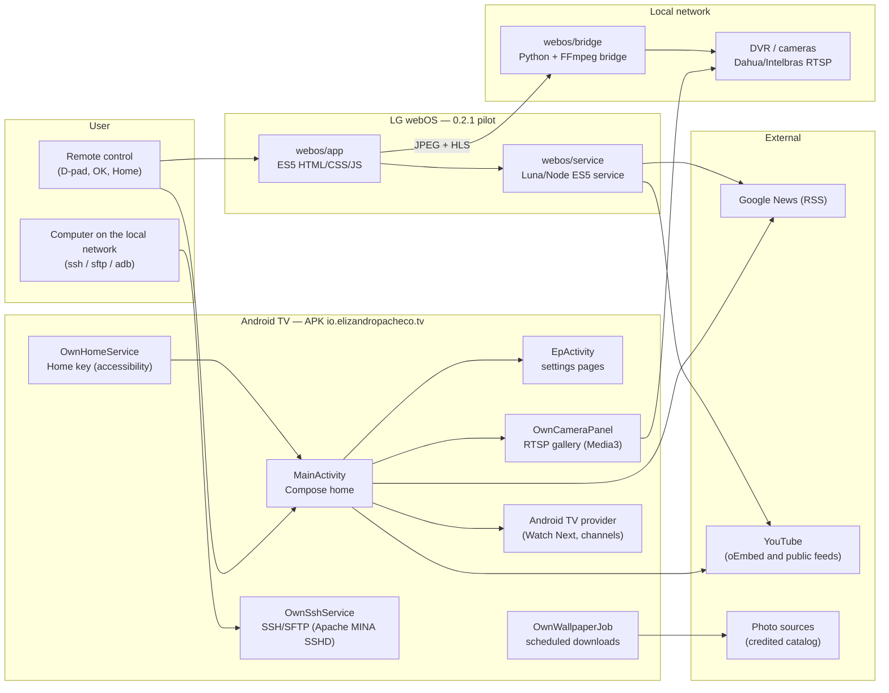

<div align="center">


<br>

**Your TV. Your rules. An open Android TV media center for apps, games and cameras, with an advertising-free home screen you control.**

[](LICENSE)
[](https://github.com/elizandropacheco/OwnTV)
[](CHANGELOG.md)
[](https://github.com/elizandropacheco/OwnTV/commits)
[](https://github.com/elizandropacheco/OwnTV/stargazers)
[](docs/VALIDATION.md)


[Português](README.md) · [Status and remaining work](docs/STATUS.pt-BR.md) · [Installation guide](docs/INSTALLATION.pt-BR.md) · [Architecture](#architecture) · [Getting started](#getting-started) · [Releases](https://github.com/elizandropacheco/OwnTV/releases) · [Changelog](CHANGELOG.md)

</div>

---

> [!NOTE]
> The Portuguese [README](README.md) is the main document and covers every menu and option. Most
> linked guides are in Portuguese.

## Contents

- [About](#about)
- [Highlights](#highlights)
- [Compatibility](#compatibility)
- [Architecture](#architecture)
- [Stack](#stack)
- [Getting started](#getting-started)
- [Usage](#usage)
- [LG webOS](#lg-webos)
- [Screenshots](#screenshots)
- [Project structure](#project-structure)
- [Tests and quality](#tests-and-quality)
- [Deploy and releases](#deploy-and-releases)
- [Documentation](#documentation)
- [Roadmap](#roadmap)
- [Contributing](#contributing)
- [Security](#security)
- [License](#license)
- [Author](#author)

## About

OwnTV turns the Android TV home screen into an organized space for apps, a console, content and
cameras. The open layout lets the wallpaper show through; the top menu, the dock and the focus
effects make remote navigation easy.

It is an open-source (GPLv3) Android launcher based on
[Couchy Launcher](https://github.com/conreo/couchy-launcher) by Conreo. The original Android
launcher and settings stay available, and everything can be reverted. A separate LG webOS pilot
exists; it is not part of the APK.

The EP identity uses a `#030B12` background, `#0084FE` blue, `#2CEB43` green, geometric lines,
translucent surfaces, gradient focus borders and brief color transitions.

## Highlights

- **Advertising-free home** — no sponsored banners, ad services or commercial launcher feed.
- **Real customization** — favorites, order, categories, hidden apps, cards, labels, actions,
  artwork, alignment and image intensity.
- **Stable focus and low overhead** — images decoded for the usable interface resolution, background
  loading, on-demand content rows and short color transitions. Speed depends on the hardware; no
  percentage gain is claimed without measurement.
- **Inputs on the home screen** — a persistent footer button opens the HDMI/device picker on Android
  and on the webOS pilot.
- **Game hub** — configurable PS5 HDMI entry, Game Master, picture settings, inputs and 120 Hz/120 FPS
  guidance.
- **Connected home** — a scrolling RTSP camera gallery, remote-controlled focus, full-resolution
  main-stream playback and shortcuts to Intelbras and iCSee apps.
- **Offline landscapes** — fifteen photographs above 4K, a catalog of 100, rotation, daily downloads
  and full credits.
- **Network access** — an SSH/SFTP server with configurable user, password and port, no ADB needed
  for each connection.
- **News on the home screen** — Google News headlines for chosen topics, in two lines, with a local
  cache.

## Compatibility

Validated on a TCL Android TV 14. TCL-specific shortcuts depend on the firmware and the HDMI input.
Minimum Android: API 26; `targetSdk` 34.

**LG/webOS** is a separate, experimental implementation (0.2.1), described in [LG webOS](#lg-webos).
The Android APK does not run on webOS.

Wallpaper files keep their source resolution. Android may render the interface below the panel's
physical resolution; decoded images follow that usable resolution to avoid wasting memory.

## Architecture



The Android app is a single Gradle module, `app`, written in Kotlin and Java. The
`com.conreo.couchytv` namespace keeps the Couchy base; the `applicationId` is
`io.elizandropacheco.tv`. The home screen (`ui/OwnTVHome.kt`) builds the menu, cards, favorites,
suggestions, clock and focus; `ui/OwnMedia.kt` reads content shared through Android TV. The LG pilot
shares no code with the APK: its interface runs on the reference TVs' Chromium 53 and its service is
Node 0.12.2 compatible. Cameras on webOS rely on a private bridge running on an always-on computer.
See [`docs/PROJECT_STRUCTURE.md`](docs/PROJECT_STRUCTURE.md).

## Stack

| Layer | Technology | Version |
|---|---|---|
| Languages | Kotlin · Java | 2.4.21 · Java 17 target |
| Build | Gradle (wrapper) · Android Gradle Plugin · R8 | 8.9 · 8.5.2 · 9.1.56 |
| Build JDK | JDK | 21 |
| Android SDK | `compileSdk` / `targetSdk` · `minSdk` · Build Tools | 34 · 26 · 35.0.0 |
| Lint | Android Lint (`android.experimental.lint.version`) | 9.4.1 |
| UI | Jetpack Compose (BOM) · `androidx.tv:tv-material` · `graphics-shapes` | 2024.09.03 · 1.0.0 · 1.0.1 |
| Video and cameras | AndroidX Media3 (ExoPlayer, RTSP, UI, OkHttp) | 1.4.1 |
| SSH/SFTP | Apache MINA SSHD (`sshd-core`, `sshd-sftp`) | 2.20.0 |
| Persistence | DataStore Preferences · kotlinx.serialization JSON | 1.1.1 · 1.7.1 |
| Performance | ProfileInstaller (baseline profile) | 1.4.1 |
| LG pilot | ES5 HTML/CSS/JavaScript · ES5 Node service · `acorn` (tests) | 0.2.1 · Node 0.12.2 on firmware · 8.18.0 |
| Camera bridge | Python · FFmpeg | 3.10+ |
| Release scripts | Python (standard library) · Bash | 3.9+ |
| Formatting | google-java-format · ktfmt · Prettier (webOS) | 1.37.0 · 0.65 · — |

Versions come from `build.gradle.kts`, `app/build.gradle.kts`, `gradle.properties`,
`gradle/wrapper/gradle-wrapper.properties`, `webos/package.json`, `docs/BUILDING.md` and
`docs/FORMATTING.md`.

## Getting started

### Prerequisites

- To install: an Android TV and, optionally, a computer with ADB.
- To build: Git, Python 3.9+, JDK 21, Android SDK (`android-34` platform, Build Tools `35.0.0` and
  `platform-tools`) and internet access for the first Gradle and dependency download.

### Install the APK

The [complete Portuguese guide](docs/INSTALLATION.pt-BR.md) covers APK downloads, developer
options, USB/network/wireless ADB debugging, pairing, install/update commands, Home accessibility,
configuration, troubleshooting and rollback. [Releases](https://github.com/elizandropacheco/OwnTV/releases)
contain the APK and SHA-256 checksums.

```sh
adb connect TV_IP:ADB_PORT
adb install -r OwnTV-0.2.4.apk
adb shell am start -n io.elizandropacheco.tv/com.conreo.couchytv.MainActivity
adb shell pm grant io.elizandropacheco.tv android.permission.READ_TV_LISTINGS
```

Choose OwnTV as Home when the firmware allows it. TCL devices may require the **OwnTV Home**
accessibility service (**Configurações → Acessibilidade**) and permission to start automatically.
The service filters only the Home key when supported, with stock Home activity redirection as a
fallback; it does not capture screen content.

> [!WARNING]
> Keep the same signing key when updating. Uninstalling or clearing app data removes local
> configuration and camera credentials.

### Build

```sh
git clone https://github.com/elizandropacheco/OwnTV.git
cd OwnTV
python3 scripts/fetch-wallpapers.py --count 15   # optional: initial photo collection
./gradlew :app:assembleDebug                     # APK in app/build/outputs/apk/debug/app-debug.apk
```

The wallpaper script downloads full-resolution photographs, preserves their pixels and removes
capture/location metadata; credits stay in the catalog. Without the photos, the launcher keeps its
vector background. On Windows, use `gradlew.bat`. Set `JAVA_HOME` and `ANDROID_HOME` (or a
`local.properties` with `sdk.dir`, never committed). Details in [`docs/BUILDING.md`](docs/BUILDING.md).

## Usage

### Customize with the remote

| Where | What you can change |
| --- | --- |
| **Personalizar apps → Aplicativos** | Show/hide apps, open app info and uninstall through the Android dialog |
| **Personalizar apps → Seções** | Create, rename, order and fill categories; set favorites |
| **Personalizar apps → Aparência** | Scale, icon size, spacing, corners, card height, dimming, effects, labels and clock |
| **Cards e jogos** | Add, remove, order and edit card title, description, action, image, alignment and intensity |
| **Imagens dos aplicativos** | Use a local/USB image or restore the default |
| **Configurações → Fundos EP** | Choose landscapes, rotation, interval and daily downloads |
| **Relógio** | Date, interface time zone and access to Android date/time settings |

Arrows move focus; **OK** opens the item. On the home screen, **Down from the top menu goes straight
to the first favorite**; **Up from favorites selects Cameras**, then PS5, then the top menu. Down
from the dock opens more content; recommendation arrows switch pages (four complete cards per page).
The remote's menu key opens OwnTV settings when the firmware passes it to the app.

**Ordem dos favoritos** moves each app before/after or to the start/end; entering the dock focuses
the first favorite. **Ícones dos favoritos** chooses uniform brand colors (default) or monochrome.
Local artwork requires a file manager compatible with Android's document picker.

### Visual identity

The EP logo is the default for the home screen, menus, startup and app identity.
**Identidade visual e logo** offers EP, the OwnTV monogram or a local/USB PNG/JPEG/WebP for the home
screen, native menus and startup animation. The animation plays on the first process start, not on
every Home return. The installed app icon keeps EP. See [branding](docs/BRANDING.md).

### News

Below the tagline, real headlines rotate in two lines. **Configurações → Notícias e temas** turns the
block on/off, accepts one to eight comma-separated topics (defaults: telecom, technology and
artificial intelligence) and sets the rotation interval. Queries go to Portuguese Google News RSS,
with the source shown and a 30-minute local cache. Full articles are never downloaded, and no
headlines are invented while offline.

### Content and YouTube

OwnTV reads content that apps publish to the Android TV provider, such as **Watch Next** and
recommendation channels. Rows respect hidden apps and can be turned off. Thumbnails keep 16:9;
captions show app/channel and publish date, and duration appears when the app provides it. Missing
dates or durations are never estimated.

When YouTube does not provide the channel name, OwnTV queries only the public oEmbed metadata: a
seven-day cache, at most three concurrent lookups, and cards appear before the lookups finish. No
account, cookie or private history is accessed. The query budget is per publisher, so one app cannot
exhaust the others. When YouTube shares no videos, OwnTV shows an explicit shortcut to open the app.
**YouTube → Inscrições** asks the app for the subscriptions page; subscription videos only appear on
the home screen if the app shares them with the system.

> [!NOTE]
> "Advertising-free" refers to OwnTV. Ads inside YouTube or other services remain controlled by
> those apps.

### PS5, Fortnite and HDMI

In **Jogos → HDMI do PS5**, choose the right input. Game Master, picture and input shortcuts open the
TV's own controls. For 120 FPS, check the PS5 120 Hz video output, the game's performance mode and
Fortnite's 120 FPS option; TV, HDMI port, cable, console and game must all support it. OwnTV does not
change the firmware or fake unsupported refresh rates. Optional game artwork is local customization
and is not included in the public source tree.

### Cameras and DVR

On **Android**, open **Câmeras → Opções do DVR → Configurar** and enter host, user, password, port
and channel count. The native implementation uses Dahua/compatible Intelbras RTSP paths
(`cam/realmonitor`).

- The gallery scrolls and keeps at most four active previews.
- **OK** opens the main stream and shows the received resolution.
- **Back** restores channel, focus and gallery position.
- **Enquadrar** offers original aspect, fill with crop or stretch; **fill** is the default.
- **Light mode** uses the substream when the main stream does not suit the connection.

Mibo, iSIC and iCSee also have shortcuts to their own apps. Camera credentials are encrypted with
AES-GCM and Android Keystore in the TV's private storage, outside the public launcher configuration.

> [!WARNING]
> Traditional RTSP has no transport encryption: use a trusted local network and never expose the DVR
> to the internet.

On **webOS**, use the [camera bridge](webos/bridge/README.md): recorder credentials stay on the
private server, and each TV gets only its own bridge key.

### SSH and SFTP

Open **Configurações → Acesso SSH e SFTP**, set a user, a password of at least ten characters and a
port between 1024 and 65535, and save to start. Only private, local or loopback addresses can
authenticate. The suggested port is 2222; status and address appear on that page.

```sh
ssh -p 2222 YOUR_USER@TV_IP
sftp -P 2222 YOUR_USER@TV_IP
```

Passwords use salted PBKDF2-HMAC-SHA256. The server key stays on the TV. The server runs as the app
user, without root or ADB privileges. SFTP starts in a dedicated transfer directory; port forwarding
is disabled. **Parar servidor SSH** stops the service and its automatic restart.

### Wallpapers and clock

Downloads use a finite photo catalog with sources and licenses in
`app/src/main/assets/ep/wallpapers/catalog.json`. Settings allow 1, 3 or 5 new photos per day and
limits of 25, 50 or 100; scheduling depends on connection, storage and Android, and a powered-off TV
does not download. The collection works offline; rotation pauses when the home screen is not
visible. The clock follows the system time zone or an IANA identifier; NTP belongs to Android.

### Revert

Disable **OwnTV Home** in accessibility and choose the original launcher as Home. The original
Google TV is also reachable from **Configurações**. No manufacturer package needs to be removed.

## LG webOS

The [experimental 0.2.1 app](webos/README.md) adds topic-based news, four public YouTube
suggestions per page and cameras through a private bridge (an always-on computer/server is required;
see the [bridge guide](webos/bridge/README.md)), alongside the Android-inspired home, wallpapers,
preferences and HDMI shortcuts. Favorites use the TV's own app catalog, with adding/removing apps,
native icons, paginated grids and remote-controlled ordering
([pairing and favorites guide](docs/LG-FAVORITOS.pt-BR.md)).

> [!IMPORTANT]
> **The physical Home button still opens LG Home.** The pilot does not have Android feature parity.
> Root, persistent SSH and Home replacement are not implemented. Browser and URL features are out of
> scope.

Developer SSH was verified on six LG 43LM631C0SB units on 2026-10-27 (firmware 05.40.97, SDK
4.10.0). See the [LG Developer account, country selection, Developer Mode, SSH and hardware guide](docs/LG-WEBOS.pt-BR.md).

```sh
npm install -g @webos-tools/cli
npm ci --prefix webos
python3 -m pip install Pillow
python3 scripts/fetch-wallpapers.py --count 15
python3 scripts/prepare-webos-assets.py
./scripts/build-webos.sh
ares-install --device lg-piloto io.elizandropacheco.owntv.webos_0.2.1_all.ipk
ares-launch --device lg-piloto io.elizandropacheco.owntv.webos
```

The build writes the IPK, `SHA256SUMS` and build info to `releases/webos/0.2.1/`.

## Screenshots

<details>
<summary>LG webOS pilot</summary>

<br>


</details>

<details>
<summary>OwnTV wordmark</summary>

<br>


</details>

## Project structure

```text
OwnTV/
├── app/                    # Android app: Kotlin/Java, Compose, services, resources and assets
│   └── src/main/java/com/conreo/couchytv/
│       ├── data/           # settings, apps and news
│       └── ui/             # Compose home and shared content
├── webos/                  # separate LG pilot
│   ├── app/                # ES5 HTML/CSS/JS interface
│   ├── service/            # content service (Luna/Node ES5)
│   ├── bridge/             # private camera bridge (Python + FFmpeg)
│   └── tests/              # Node and Python tests
├── scripts/                # build, packaging, public-asset check, wallpapers, formatting
├── releases/               # release index, hashes and metadata (APK/IPK live on GitHub Releases)
├── docs/                   # installation, build, status, validation, security, LG, IoT/Alexa
├── fastlane/metadata/      # Android description and changelogs
├── art/                    # base project artwork
├── gradle/wrapper/         # project-controlled Gradle
├── build.gradle.kts        # plugin versions and build-dependency fixes
├── settings.gradle.kts     # :app module and Maven repositories
└── gradle.properties       # build options and Lint version
```

Source is directly browsable; no source ZIP is required. Editable logo masters are not distributed;
only rendered PNG derivatives are published.

## Tests and quality

```sh
python3 scripts/check-public-assets.py   # blocks known private files in the public tree
./scripts/test-ssh-security.sh           # SSH access policy on a local JVM (no TV or network)
python3 scripts/test-image-privacy.py    # offline image privacy regression tests
./scripts/format-code.sh --check         # google-java-format and ktfmt, without changing files
npm test --prefix webos                  # ES5, model, content, service and app discovery
python3 webos/tests/bridge_test.py       # camera bridge
```

`./scripts/build-release.sh` builds, runs Lint, validates the package and only then updates the
release folder. What was verified for each version is in [`docs/VALIDATION.md`](docs/VALIDATION.md).

> [!NOTE]
> There is no active remote CI. `docs/ci/build.workflow.yml` is only a template until it is
> configured under `.github/workflows/`.

## Deploy and releases

```sh
./scripts/build-release.sh
```

The script writes the APK, checksum and `build-info.json` to `releases/<version>/`. Release builds
are unsigned by default; `KEYSTORE_FILE`, `KEYSTORE_PASSWORD`, `KEY_ALIAS` and `KEY_PASSWORD`
configure your own signing, and `--local-sign` uses the local debug key for compatibility with the
initial install. Never commit keys, passwords, device backups or real profiles.

APKs and IPKs are attached to [GitHub Releases](https://github.com/elizandropacheco/OwnTV/releases);
checksums and metadata are versioned in `releases/`. Verify a download with
`shasum -a 256 -c SHA256SUMS.txt`. The publishing flow is in
[`docs/BUILDING.md`](docs/BUILDING.md#publicar-uma-versão) and the index in
[`releases/README.md`](releases/README.md).

## Documentation

| Document | Content |
|---|---|
| [Status and remaining work](docs/STATUS.pt-BR.md) | Android × LG matrix, pending items and completion criteria |
| [Installation](docs/INSTALLATION.pt-BR.md) | APK, developer mode, ADB, Home, troubleshooting and rollback |
| [Build and publish](docs/BUILDING.md) | Requirements, build, signing and publishing |
| [Code structure](docs/PROJECT_STRUCTURE.md) | File map and responsibilities |
| [Validation](docs/VALIDATION.md) | What was verified in each version |
| [Security review](docs/SECURITY_REVIEW.md) | Scope, tools, results and limits |
| [Formatting](docs/FORMATTING.md) | Java/Kotlin formatters and ES5 rules |
| [Branding](docs/BRANDING.md) | Published files and customization |
| [LG webOS](docs/LG-WEBOS.pt-BR.md) · [LG favorites](docs/LG-FAVORITOS.pt-BR.md) | Account, Developer Mode, hardware and favorites |
| [webOS pilot](webos/README.md) · [Camera bridge](webos/bridge/README.md) | webOS features, build and limits |
| [IoT and Alexa](docs/IOT-ALEXA.md) | Technical study (proposal, not implemented) |
| [Original Couchy README](docs/UPSTREAM_README.md) | Upstream reference |

## Roadmap

The [project status](docs/STATUS.pt-BR.md) lists pending work by priority, each with its completion
criterion: replacing Home on LG TVs, a camera bridge independent of a manual Mac session, long-run
camera validation, a physical test of APK 0.2.4 on the TCL and enabling CI on GitHub, among others.

**IoT and Alexa — proposal.** The [feasibility study](docs/IOT-ALEXA.md) recommends OwnTV as a panel
and lightweight bridge, Home Assistant on an always-on host and Alexa through the Cloud integration
first. It is a roadmap, not an implemented feature.

## Contributing

Contributions are welcome. Follow the [contribution guide](CONTRIBUTING.md) (Portuguese):

- Use a fresh clone (logo history was rewritten; do not merge older branches).
- Branch from `main`, use [Conventional Commits](https://www.conventionalcommits.org/)
  (`feat(webos):`, `fix:`, `docs:`…) and keep each change focused on one observable behavior.
- Keep D-pad access working, preserve existing preferences and put translatable text in
  `res/values/`.
- Update the Portuguese README, this summary, the matching guide and `CHANGELOG.md` in the same
  change set.
- Run `python3 scripts/check-public-assets.py` and `./scripts/build-release.sh`, and describe the
  problem, change, tests and limitations in the PR.

Code contributions are licensed under GPLv3. If OwnTV helped your TV,
[star it on GitHub](https://github.com/elizandropacheco/OwnTV).

## Security

Do not open public issues for vulnerabilities. Report privately through
[GitHub Security Advisories](https://github.com/elizandropacheco/OwnTV/security/advisories/new) or
contact the author on [GitHub](https://github.com/elizandropacheco). Never include real camera data,
tokens, device dumps or access details. See [SECURITY.md](SECURITY.md) and the documented
[security review](docs/SECURITY_REVIEW.md).

## License

OwnTV is licensed under the **GNU General Public License v3** — see [LICENSE](LICENSE). It is based
on [Couchy Launcher](https://github.com/conreo/couchy-launcher) by Conreo; upstream copyright,
license and attribution are retained.

Photographs keep their individual licenses and attribution. Simple Icons logo paths are CC0;
trademarks belong to their owners. The EP marks and personal visual identity belong to Elizandro
Pacheco. Third-party components and non-distributed content are listed in
[LICENSING.md](LICENSING.md).

## Author

<table>
  <tr>
    <td align="center">
      <a href="https://github.com/elizandropacheco">
        <br>
        <sub><b>Elizandro Pacheco</b></sub>
      </a><br>
      <sub>Developer and project author</sub>
    </td>
  </tr>
</table>

[](https://elizandropacheco.io)
[](https://www.linkedin.com/in/elizandropacheco)
[](https://github.com/elizandropacheco)
[](https://www.youtube.com/@ElizandroPacheco)
[](https://www.instagram.com/elizandropacheco)

<div align="center">
<sub>Made by <a href="https://github.com/elizandropacheco">Elizandro Pacheco</a></sub>
</div>
