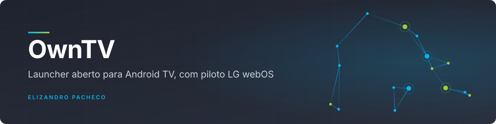
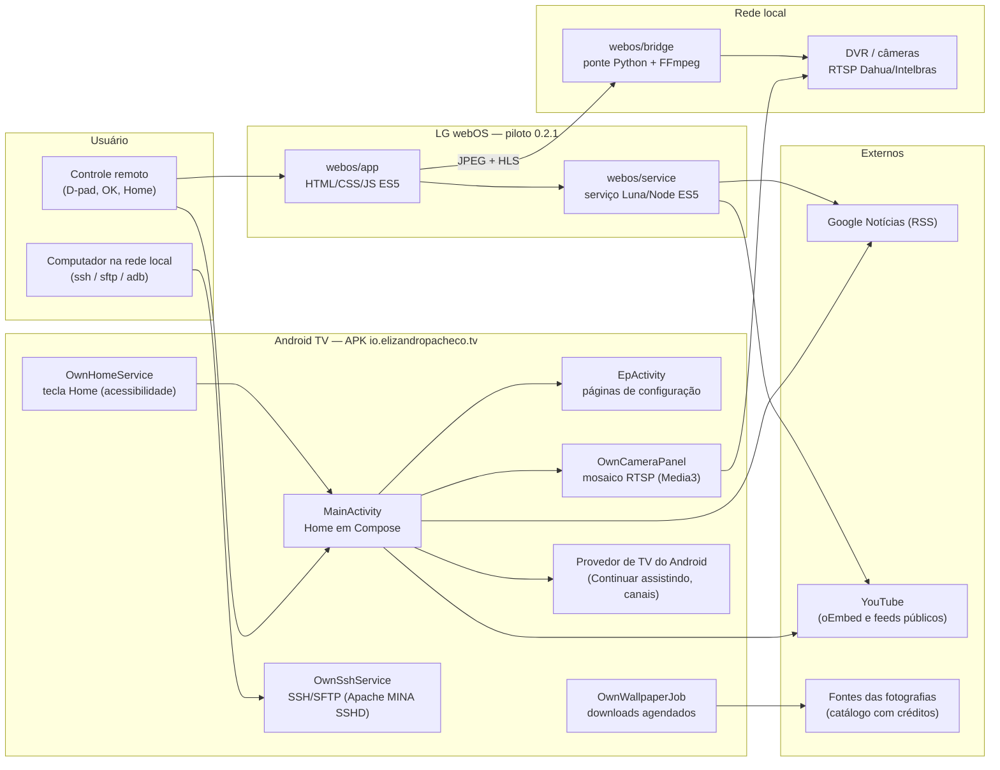
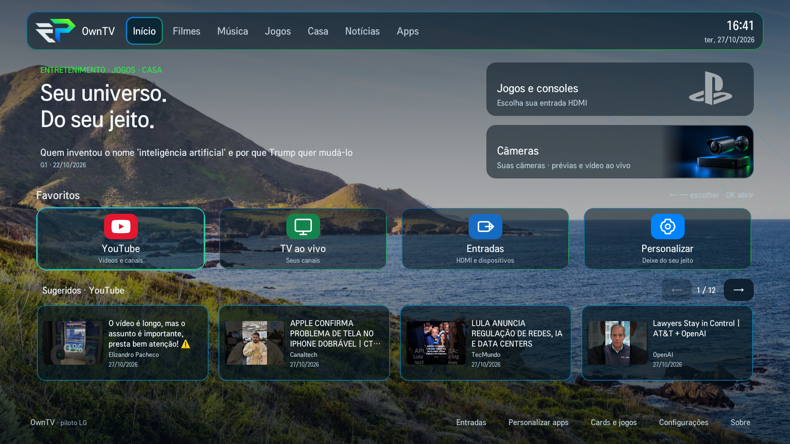
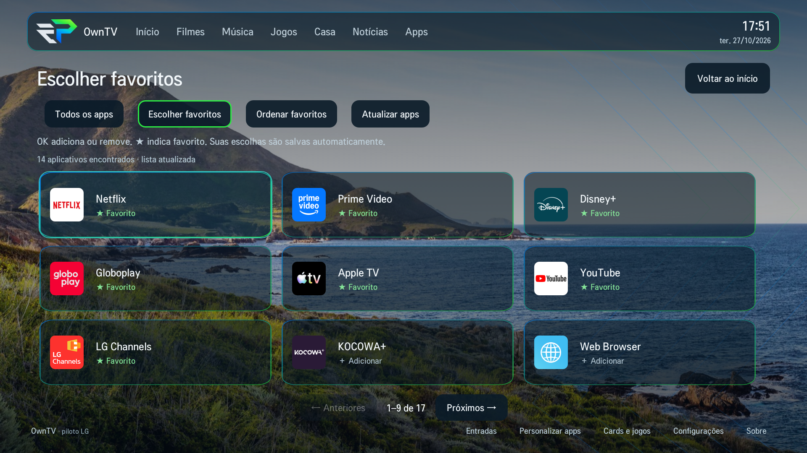

<div align="center">



<br>

**Sua TV. Suas regras. Uma central de entretenimento, jogos e câmeras para Android TV, sem publicidade na Home e com a personalização nas suas mãos.**

[](LICENSE)
[](https://github.com/elizandropacheco/OwnTV)
[](CHANGELOG.md)
[](https://github.com/elizandropacheco/OwnTV/commits)
[](https://github.com/elizandropacheco/OwnTV/stargazers)
[](docs/VALIDATION.md)


[English](README.en.md) · [Estado e pendências](docs/STATUS.pt-BR.md) · [Instalação](docs/INSTALLATION.pt-BR.md) · [Arquitetura](#arquitetura) · [Começando](#começando) · [Releases](https://github.com/elizandropacheco/OwnTV/releases) · [Changelog](CHANGELOG.md)

</div>

---

## Sumário

- [Sobre](#sobre)
- [Destaques](#destaques)
- [Compatibilidade](#compatibilidade)
- [Arquitetura](#arquitetura)
- [Stack](#stack)
- [Começando](#começando)
- [Uso](#uso)
- [LG webOS](#lg-webos)
- [Capturas de tela](#capturas-de-tela)
- [Estrutura do projeto](#estrutura-do-projeto)
- [Testes e qualidade](#testes-e-qualidade)
- [Deploy e releases](#deploy-e-releases)
- [Documentação](#documentação)
- [Roadmap](#roadmap)
- [Contribuição](#contribuição)
- [Segurança](#segurança)
- [Licença](#licença)
- [Autor](#autor)

## Sobre

OwnTV transforma a tela inicial da Android TV em um espaço organizado para aplicativos, console,
conteúdos e câmeras. A composição aberta deixa o wallpaper aparecer; o menu superior, o dock e os
efeitos de foco ajudam a navegar pelo controle remoto.

É um launcher Android de código aberto (GPLv3) baseado no
[Couchy Launcher](https://github.com/conreo/couchy-launcher), de Conreo. O launcher e as
configurações originais do Android continuam disponíveis, e tudo pode ser revertido. Há também um
piloto separado para LG webOS, que não faz parte do APK.

A identidade EP usa fundo `#030B12`, azul `#0084FE`, verde `#2CEB43`, linhas geométricas,
superfícies translúcidas, contornos em gradiente e transições suaves de foco.

## Destaques

- **Home sem publicidade** — sem banners patrocinados, serviços de anúncios ou feed comercial do
  launcher.
- **Personalização real** — favoritos, ordem, categorias, aplicativos ocultos, cards, títulos,
  ações, imagens, enquadramento e transparência.
- **Foco estável e leveza** — imagens decodificadas para a resolução útil da interface,
  carregamento em segundo plano, listas sob demanda e transições curtas de cor. A velocidade depende
  do hardware; o projeto não promete ganho percentual sem medição.
- **Entradas na Home** — botão fixo no rodapé abre o seletor HDMI/dispositivos no Android e no
  piloto webOS.
- **Central de jogos** — PS5 por HDMI configurável, Game Master, ajustes de imagem, entradas e
  orientação para 120 Hz/120 FPS.
- **Casa conectada** — mosaico de câmeras RTSP com rolagem, foco pelo controle, imagem ampliada pelo
  fluxo principal e atalhos para aplicativos Intelbras e iCSee.
- **Paisagens offline** — coleção inicial de 15 fotos acima de 4K, catálogo de 100 fotos, rotação,
  downloads diários e créditos completos.
- **Acesso pela rede** — servidor SSH e SFTP com usuário, senha e porta configuráveis, sem exigir ADB
  para cada conexão.
- **Notícias na Home** — manchetes do Google Notícias por temas, em duas linhas, com cache local.

## Compatibilidade

Validado em uma TCL com Android TV 14. Os atalhos específicos da TCL dependem do firmware e da
entrada HDMI. Android mínimo: API 26; `targetSdk` 34.

**LG/webOS** é uma implementação separada, experimental (0.2.1), descrita em [LG webOS](#lg-webos).
O APK Android não roda em webOS.

Os arquivos dos wallpapers mantêm a resolução original. A resolução da interface é determinada pelo
Android e pode ser inferior à resolução física do painel; o launcher adapta a decodificação à
interface para evitar consumo desnecessário de memória.

## Arquitetura



O aplicativo Android é um único módulo Gradle, `app`, em Kotlin e Java. O namespace
`com.conreo.couchytv` preserva a base do Couchy; o `applicationId` é `io.elizandropacheco.tv`. A
Home (`ui/OwnTVHome.kt`) monta menu, cards, favoritos, sugestões, relógio e foco; `ui/OwnMedia.kt`
lê o conteúdo compartilhado pelo Android TV. O piloto LG não compartilha código com o APK: a
interface roda no Chromium 53 das TVs de referência e o serviço é compatível com Node 0.12.2. As
câmeras no webOS dependem de uma ponte privada em um computador ligado. O mapa completo está em
[`docs/PROJECT_STRUCTURE.md`](docs/PROJECT_STRUCTURE.md).

## Stack

| Camada | Tecnologia | Versão |
|---|---|---|
| Linguagens | Kotlin · Java | 2.4.21 · alvo Java 17 |
| Build | Gradle (wrapper) · Android Gradle Plugin · R8 | 8.9 · 8.5.2 · 9.1.56 |
| JDK de build | JDK | 21 |
| SDK Android | `compileSdk` / `targetSdk` · `minSdk` · Build Tools | 34 · 26 · 35.0.0 |
| Lint | Android Lint (`android.experimental.lint.version`) | 9.4.1 |
| Interface | Jetpack Compose (BOM) · `androidx.tv:tv-material` · `graphics-shapes` | 2024.09.03 · 1.0.0 · 1.0.1 |
| Vídeo e câmeras | AndroidX Media3 (ExoPlayer, RTSP, UI, OkHttp) | 1.4.1 |
| SSH/SFTP | Apache MINA SSHD (`sshd-core`, `sshd-sftp`) | 2.20.0 |
| Persistência | DataStore Preferences · kotlinx.serialization JSON | 1.1.1 · 1.7.1 |
| Desempenho | ProfileInstaller (baseline profile) | 1.4.1 |
| Piloto LG | HTML/CSS/JavaScript ES5 · serviço Node ES5 · `acorn` (testes) | 0.2.1 · Node 0.12.2 no firmware · 8.18.0 |
| Ponte de câmeras | Python · FFmpeg | 3.10+ |
| Scripts de entrega | Python (biblioteca padrão) · Bash | 3.9+ |
| Formatação | google-java-format · ktfmt · Prettier (webOS) | 1.37.0 · 0.65 · — |

Versões de `build.gradle.kts`, `app/build.gradle.kts`, `gradle.properties`,
`gradle/wrapper/gradle-wrapper.properties`, `webos/package.json`, `docs/BUILDING.md` e
`docs/FORMATTING.md`.

## Começando

### Pré-requisitos

- Para instalar: uma Android TV e, opcionalmente, um computador com ADB.
- Para compilar: Git, Python 3.9+, JDK 21, Android SDK (plataforma `android-34`, Build Tools
  `35.0.0` e `platform-tools`) e internet para o primeiro download do Gradle e das dependências.

### Instalar o APK

**[Guia completo: APK, modo desenvolvedor, depuração ADB, instalação, configuração e reversão](docs/INSTALLATION.pt-BR.md)**
· **[Baixar versões](https://github.com/elizandropacheco/OwnTV/releases)**

1. Faça backup das configurações do launcher atual. Preserve seus APKs e um caminho de acesso às
   configurações do Android.
2. Baixe o APK da [release atual](https://github.com/elizandropacheco/OwnTV/releases/latest) ou
   compile com o script abaixo e permita sua instalação na TV.
3. Instale por um gerenciador de arquivos ou, com ADB já autorizado:

   ```sh
   adb connect TV_IP:PORTA_ADB
   adb install -r OwnTV-0.2.4.apk
   adb shell am start -n io.elizandropacheco.tv/com.conreo.couchytv.MainActivity
   ```

4. Se o Android permitir, escolha OwnTV como aplicativo de início. Em firmwares TCL que insistem no
   launcher original, ative **OwnTV Home** em **Configurações → Acessibilidade** e permita a
   inicialização automática do aplicativo nas opções da TCL.
5. Para o conteúdo compartilhado pelos aplicativos, conceda a permissão de leitura de listas da TV
   quando disponível. Pela instalação ADB:

   ```sh
   adb shell pm grant io.elizandropacheco.tv android.permission.READ_TV_LISTINGS
   ```

O serviço OwnTV Home intercepta somente a tecla Home quando o firmware permite, para abrir
diretamente o OwnTV. Como alternativa, reage à abertura da atividade Home do launcher original. Não
captura nem registra o conteúdo das telas. Alguns firmwares fixam a prioridade do launcher original;
a disponibilidade da interceptação depende do aparelho.

> [!WARNING]
> **Atualizações:** use a mesma chave de assinatura. Desinstalar ou limpar os dados apaga a
> configuração local e o acesso às câmeras; não faça isso para contornar uma assinatura diferente.

### Compilar

```sh
git clone https://github.com/elizandropacheco/OwnTV.git
cd OwnTV
python3 scripts/fetch-wallpapers.py --count 15   # opcional: fotografias da coleção inicial
./gradlew :app:assembleDebug                     # APK em app/build/outputs/apk/debug/app-debug.apk
```

O script de wallpapers baixa fotografias em resolução completa, preserva os pixels e retira
metadados de captura e localização; os créditos permanecem no catálogo. Sem as fotos, o launcher
mantém o fundo vetorial. No Windows, use `gradlew.bat`. Configure `JAVA_HOME` e `ANDROID_HOME` (ou
`local.properties` com `sdk.dir`, que não deve ser commitado). Detalhes em
[`docs/BUILDING.md`](docs/BUILDING.md).

## Uso

### Personalizar pelo controle

| Onde | O que pode mudar |
| --- | --- |
| **Personalizar apps → Aplicativos** | Mostrar/ocultar apps, abrir informações e desinstalar pelo diálogo do Android |
| **Personalizar apps → Seções** | Criar, renomear, ordenar e preencher categorias; definir favoritos |
| **Personalizar apps → Aparência** | Escala, tamanho dos ícones, espaçamento, cantos, altura dos cards, escurecimento, efeitos, nomes e relógio |
| **Cards e jogos** | Adicionar, remover, ordenar e editar título, descrição, ação, imagem, alinhamento e intensidade dos cards |
| **Imagens dos aplicativos** | Usar uma imagem local/USB ou restaurar a imagem padrão |
| **Configurações → Fundos EP** | Escolher paisagem, alternância, intervalo e downloads diários |
| **Relógio** | Data, fuso da interface e acesso à configuração de data/hora do Android |

As setas movem o foco; **OK** abre o item. Na Home, **↓ no menu superior vai direto ao primeiro
favorito**. **↑ nos favoritos seleciona Câmeras**, outro ↑ seleciona PS5 e outro ↑ volta ao menu
superior. No sentido inverso, ↓ percorre PS5 → Câmeras → favoritos. No dock, **↓** leva aos
conteúdos abaixo. As recomendações usam quatro cards completos por página, com setas para avançar e
voltar. O botão de menu do controle abre as configurações do OwnTV quando o firmware entrega essa
tecla ao aplicativo.

Em **Configurações → Personalizar sua central → Ordem dos favoritos**, mova cada app antes/depois ou
para o início/fim. Ao entrar no dock, o primeiro favorito à esquerda recebe o foco. Em **Ícones dos
favoritos**, escolha cores uniformes por marca (padrão) ou o modo monocromático. Artes vetoriais
ficam brancas no modo monocromático; imagens personalizadas e ícones nativos usam tons de cinza. A
Home aguarda a arte definitiva em vez de mostrar primeiro um ícone antigo.

A seleção de arquivos locais depende de um gerenciador compatível com o seletor de documentos do
Android.

### Identidade visual

O logo EP é o padrão da Home, dos menus, da abertura e da identidade do aplicativo. Em
**Configurações → Personalizar sua central → Identidade visual e logo**, escolha EP, o monograma
OwnTV ou uma imagem local/USB para Home, menus e abertura. A animação aparece na primeira abertura
do processo e não se repete a cada retorno pelo botão Home. O ícone do aplicativo instalado mantém
a assinatura EP. Veja [a política de identidade](docs/BRANDING.md).

### Notícias na Home

Abaixo do slogan, manchetes reais alternam em duas linhas, com espaço reservado para não deslocar a
tela. Em **Configurações → Notícias e temas**, ative/desative o bloco, informe de um a oito temas
separados por vírgulas e escolha o intervalo de alternância. Os temas iniciais são telecom,
tecnologia e inteligência artificial.

As consultas usam o RSS do Google Notícias em português, com fonte identificada e cache local de
30 minutos. Os termos escolhidos são enviados ao serviço para buscar as manchetes. O aplicativo não
baixa os artigos completos nem inventa notícias quando está sem conexão.

### Conteúdos e YouTube

OwnTV lê os conteúdos que os aplicativos publicam no provedor de TV do Android, como **Continuar
assistindo** e canais de recomendações. As linhas respeitam aplicativos ocultos e podem ser
desligadas. As miniaturas preservam a proporção 16:9; o rodapé mostra aplicativo/canal e data de
publicação, e a duração aparece sobre a imagem quando o aplicativo fornece esses dados. Datas ou
durações ausentes não são estimadas.

Quando o YouTube não fornece o nome do canal no provedor, o OwnTV consulta somente os metadados
públicos do vídeo pelo endpoint oEmbed do YouTube: cache de sete dias, no máximo três consultas
simultâneas, e os cards aparecem antes de essas consultas terminarem. Nenhuma conta, cookie ou
histórico privado é acessado.

A primeira linha de conteúdo é a do YouTube: recomendações publicadas pelo aplicativo ou
continuidade, quando disponível. A leitura tem limites por aplicativo, para que uma fonte com muitos
itens não elimine as outras. Quando o YouTube não publica vídeos no provedor do Android, o OwnTV
mostra um atalho explícito para abrir o aplicativo.

O atalho **YouTube → Inscrições** solicita a página de inscrições ao aplicativo. Os vídeos dos
canais inscritos só aparecem diretamente na Home se o aplicativo os compartilhar com o sistema; o
launcher não acessa senhas, cookies ou a conta do YouTube.

> [!NOTE]
> A ausência de anúncios se refere ao OwnTV. Publicidade dentro do YouTube ou de outros serviços
> continua sob controle de cada aplicativo.

### PS5, Fortnite e HDMI

Em **Jogos → HDMI do PS5**, escolha a entrada correta. Os atalhos de Game Master, imagem e entradas
abrem os controles do aparelho.

Para 120 FPS, confira no PS5 a saída de vídeo a 120 Hz, o modo de desempenho do jogo e a opção de
120 FPS do Fortnite. TV, porta HDMI, cabo, console e jogo precisam oferecer o modo desejado. OwnTV
não altera o firmware nem inventa suporte a frequências indisponíveis.

As artes opcionais de jogos são personalização local. O código público inclui uma ilustração de
fallback; arquivos e marcas de terceiros têm suas próprias condições de uso.

### Câmeras e DVR

No **Android**, abra **Câmeras → Opções do DVR → Configurar** e informe host, usuário, senha, porta e
quantidade de canais. A implementação nativa usa RTSP no formato Dahua/Intelbras compatível com
`cam/realmonitor`.

- O mosaico é rolável e mantém no máximo quatro prévias ativas.
- **OK** abre o fluxo principal, mostrando a resolução recebida.
- **Voltar** restaura canal, foco e posição do mosaico.
- **Enquadrar** oferece proporção original, preenchimento com corte ou esticar. **Preencher** é o
  padrão.
- **Modo leve** usa o substream quando o principal não for adequado à conexão.

Mibo, iSIC e iCSee também têm atalhos para seus próprios aplicativos. A integração nativa não
substitui protocolos proprietários de todos os modelos.

As credenciais do DVR ficam criptografadas com AES-GCM e Android Keystore no armazenamento privado
da TV. Não entram nas configurações públicas do projeto nem no catálogo de imagens. Este
repositório não contém endereços ou acessos de instalações reais.

> [!WARNING]
> RTSP tradicional não oferece criptografia de transporte: use uma rede local confiável e não
> exponha o DVR na internet.

No **webOS**, use [a ponte de câmeras](webos/bridge/README.md). As credenciais do gravador ficam no
servidor privado; a TV recebe somente uma chave própria da ponte.

### SSH e SFTP

Em **Configurações → Acesso SSH e SFTP**, escolha usuário, senha com pelo menos dez caracteres e uma
porta entre 1024 e 65535. Salve para iniciar. O serviço aceita autenticação somente de endereços
privados, locais ou de loopback; use apenas uma rede confiável. A porta sugerida é 2222; o status e o
endereço aparecem nessa página. O serviço mantém uma notificação enquanto está ativo e volta após a
inicialização quando habilitado.

```sh
ssh -p 2222 SEU_USUARIO@TV_IP
sftp -P 2222 SEU_USUARIO@TV_IP
```

A senha não é guardada em texto: usa PBKDF2-HMAC-SHA256 com salt individual. A chave do servidor
permanece na TV. O terminal executa como o usuário do OwnTV, com as permissões normais do Android,
sem root ou permissões equivalentes ao ADB. O SFTP inicia numa pasta própria para transferência de
arquivos. Encaminhamento de portas está desativado.

Use **Parar servidor SSH** para desativar o acesso e o reinício automático. Usuário, senha e dados
reais da rede não devem ser publicados em issues, exemplos ou commits.

### Wallpapers e relógio

Os downloads usam um catálogo finito de fotografias com fontes e licenças registradas em
`app/src/main/assets/ep/wallpapers/catalog.json`. A TV guarda os originais na área privada do
aplicativo. A configuração permite 1, 3 ou 5 novas fotos por dia e limites de 25, 50 ou 100. O
agendamento depende de conexão, espaço e decisões do Android; a TV desligada não faz downloads.

A coleção continua funcionando offline. A rotação pausa quando a Home não está visível; apenas a
imagem corrente e a transição precisam ficar decodificadas.

O relógio pode acompanhar o fuso do sistema ou usar um identificador IANA. A sincronização NTP
pertence ao Android. Na TCL de referência foi usado `a.ntp.br`; outras instalações podem ajustar
isso pelas ferramentas e permissões disponíveis no aparelho.

### Reverter

Desative **OwnTV Home** na acessibilidade e escolha o launcher original como início. O acesso ao
Google TV original também está em **Configurações**. Se o OwnTV tiver sido escolhido como Home pelo
Android, remova essa preferência nas configurações do sistema. Nenhum pacote do fabricante precisa
ser removido.

## LG webOS

A [versão experimental 0.2.1](webos/README.md) acrescenta, além da Home, fundos, favoritos e
entradas no estilo Android:

- notícias por temas;
- sugestões públicas do YouTube, com quatro cards por página;
- câmeras por uma ponte privada, que exige um computador/servidor ligado
  ([como configurar](webos/bridge/README.md));
- **favoritos escolhidos entre os apps da própria TV e ordenados com o controle**, com ícones
  nativos e paginação ([como configurar](docs/LG-FAVORITOS.pt-BR.md)).

> [!IMPORTANT]
> **O botão Home continua abrindo a LG.** O piloto não reproduz todas as integrações Android. Root,
> usuário SSH extra e SSH permanente não estão implementados. Navegador e abertura de URLs estão
> fora do escopo.

Consulte [conta LG Developer, correção de país, Developer Mode, SSH e hardware](docs/LG-WEBOS.pt-BR.md)
e o [registro dos testes nas seis unidades](docs/VALIDATION.md) (LG 43LM631C0SB, firmware
05.40.97, SDK 4.10.0).

Para compilar o IPK:

```sh
npm install -g @webos-tools/cli
npm ci --prefix webos
python3 -m pip install Pillow
python3 scripts/fetch-wallpapers.py --count 15
python3 scripts/prepare-webos-assets.py
./scripts/build-webos.sh
```

O build grava IPK, `SHA256SUMS` e `build-info` em `releases/webos/0.2.1/`. Instalação com a CLI da
LG, para cada TV cadastrada:

```sh
ares-install --device lg-piloto io.elizandropacheco.owntv.webos_0.2.1_all.ipk
ares-launch --device lg-piloto io.elizandropacheco.owntv.webos
```

## Capturas de tela

<details>
<summary>Piloto LG webOS</summary>

<br>





</details>

<details>
<summary>Marca OwnTV</summary>

<br>


</details>

## Estrutura do projeto

```text
OwnTV/
├── app/                    # aplicativo Android: Kotlin/Java, Compose, serviços, recursos e assets
│   └── src/main/java/com/conreo/couchytv/
│       ├── data/           # configurações, apps e notícias
│       └── ui/             # Home em Compose e conteúdo compartilhado
├── webos/                  # piloto LG separado
│   ├── app/                # interface HTML/CSS/JS ES5
│   ├── service/            # serviço de conteúdo (Luna/Node ES5)
│   ├── bridge/             # ponte privada de câmeras (Python + FFmpeg)
│   └── tests/              # testes Node e Python
├── scripts/                # build, empacotamento, verificação de arquivos públicos, wallpapers, formatação
├── releases/               # índice das versões, hashes e metadados (APK/IPK ficam na GitHub Release)
├── docs/                   # instalação, build, estado, validação, segurança, LG, IoT/Alexa
├── fastlane/metadata/      # descrição e changelogs Android
├── art/                    # artes do projeto base
├── gradle/wrapper/         # Gradle controlado pelo projeto
├── build.gradle.kts        # versões dos plugins e ajustes de dependências de build
├── settings.gradle.kts     # módulo :app e repositórios Maven
└── gradle.properties       # opções de build e versão do Lint
```

O código-fonte fica navegável no repositório, sem depender de um pacote ZIP. Os originais editáveis
dos logos não são distribuídos; o aplicativo e a documentação usam PNGs renderizados.

## Testes e qualidade

```sh
python3 scripts/check-public-assets.py   # bloqueia arquivos privados conhecidos na árvore pública
./scripts/test-ssh-security.sh           # política de acesso SSH em JVM local (sem TV nem rede)
python3 scripts/test-image-privacy.py    # regressão de privacidade das imagens (offline)
./scripts/format-code.sh --check         # google-java-format e ktfmt, sem alterar arquivos
```

```sh
npm test --prefix webos                  # ES5, modelo, conteúdo, serviço e descoberta de apps
python3 webos/tests/bridge_test.py       # ponte de câmeras
```

`./scripts/build-release.sh` compila, executa o lint, valida o pacote e só então atualiza a entrega.
O registro do que foi verificado em cada versão está em [`docs/VALIDATION.md`](docs/VALIDATION.md).

> [!NOTE]
> Não há CI remota ativa. `docs/ci/build.workflow.yml` é apenas um modelo; só vale depois de
> configurado em `.github/workflows/`.

## Deploy e releases

```sh
./scripts/build-release.sh
```

O script grava APK, checksum e `build-info.json` em `releases/<versão>/`. A compilação release é sem
assinatura por padrão; as variáveis `KEYSTORE_FILE`, `KEYSTORE_PASSWORD`, `KEY_ALIAS` e
`KEY_PASSWORD` configuram uma assinatura própria, e `--local-sign` usa a chave debug local para
compatibilidade com a instalação inicial. Não envie chaves, senhas, backups de aparelhos ou perfis
reais para o repositório.

Os APKs e IPKs ficam anexados às [GitHub Releases](https://github.com/elizandropacheco/OwnTV/releases);
hashes e metadados são versionados em `releases/`. Para conferir um download:

```sh
shasum -a 256 -c SHA256SUMS.txt
```

O fluxo de publicação (versão, tag e `gh release create`) está em
[`docs/BUILDING.md`](docs/BUILDING.md#publicar-uma-versão) e o índice em
[`releases/README.md`](releases/README.md).

## Documentação

| Documento | Conteúdo |
|---|---|
| [Estado e pendências](docs/STATUS.pt-BR.md) | Matriz Android × LG, pendências e critérios de conclusão |
| [Instalação](docs/INSTALLATION.pt-BR.md) | APK, modo desenvolvedor, ADB, Home, diagnóstico e reversão |
| [Compilar e publicar](docs/BUILDING.md) | Requisitos, build, assinatura e publicação |
| [Estrutura do código](docs/PROJECT_STRUCTURE.md) | Mapa de arquivos e responsabilidades |
| [Validação](docs/VALIDATION.md) | O que foi verificado em cada versão |
| [Revisão de segurança](docs/SECURITY_REVIEW.md) | Escopo, ferramentas, resultados e limites |
| [Formatação](docs/FORMATTING.md) | Formatadores Java/Kotlin e regras ES5 |
| [Identidade visual](docs/BRANDING.md) | Arquivos publicados e personalização |
| [LG webOS](docs/LG-WEBOS.pt-BR.md) · [Favoritos LG](docs/LG-FAVORITOS.pt-BR.md) | Conta, Developer Mode, hardware e favoritos |
| [Piloto webOS](webos/README.md) · [Ponte de câmeras](webos/bridge/README.md) | Recursos, build e limites do webOS |
| [IoT e Alexa](docs/IOT-ALEXA.md) | Estudo técnico (proposta, não implementado) |
| [README original do Couchy](docs/UPSTREAM_README.md) | Referência do projeto base |

## Roadmap

O [estado do projeto](docs/STATUS.pt-BR.md) lista as pendências em ordem de prioridade, cada uma
com o critério para considerá-la concluída: substituir a Home nas LG, ponte de câmeras independente
da sessão manual do Mac, validação longa das câmeras, teste físico do APK 0.2.4 na TCL e ativação
da CI no GitHub, entre outras.

**IoT e Alexa — proposta.** O [estudo técnico](docs/IOT-ALEXA.md) recomenda OwnTV como painel e
ponte leve, Home Assistant em um host sempre ligado e Alexa pela integração Cloud inicialmente.
Inclui alternativas, protocolos, arquitetura, limites do standby da TCL, segurança, custos e
testes. Esses recursos são um roteiro e ainda não fazem parte do APK.

## Contribuição

Contribuições são bem-vindas. Siga o [guia de contribuição](CONTRIBUTING.md):

- Use um clone novo (o histórico dos logos foi limpo; não mescle branches anteriores).
- Crie um branch a partir de `main`, use [Conventional Commits](https://www.conventionalcommits.org/)
  (`feat(webos):`, `fix:`, `docs:`…) e mantenha cada mudança focada em um comportamento observável.
- Garanta acesso por D-pad, preserve preferências existentes e use `res/values/` para textos
  traduzíveis.
- Atualize este README, o resumo em inglês, o guia correspondente e o `CHANGELOG.md` no mesmo
  conjunto de alterações.
- Rode `python3 scripts/check-public-assets.py` e `./scripts/build-release.sh` e descreva no PR
  problema, mudança, testes e limitações.

Contribuições de código seguem a GPLv3. Se o OwnTV ajudou sua TV,
[dê uma estrela no GitHub](https://github.com/elizandropacheco/OwnTV).

## Segurança

Não abra issue pública para vulnerabilidades. Reporte de forma privada pelo
[GitHub Security Advisories](https://github.com/elizandropacheco/OwnTV/security/advisories/new) ou
fale diretamente com o autor pelo [GitHub](https://github.com/elizandropacheco). Nunca inclua dados
reais de câmeras, tokens, dumps de aparelhos ou detalhes de acesso. A política completa está em
[SECURITY.md](SECURITY.md) e a revisão documentada em
[`docs/SECURITY_REVIEW.md`](docs/SECURITY_REVIEW.md).

## Licença

OwnTV é distribuído sob a **GNU General Public License v3** — veja [LICENSE](LICENSE). Baseado no
[Couchy Launcher](https://github.com/conreo/couchy-launcher), de Conreo; a licença, os créditos e a
referência ao projeto original são preservados.

Fotografias mantêm as licenças individuais do catálogo e dos créditos. Os caminhos de logos do
Simple Icons são CC0; marcas continuam pertencendo aos respectivos titulares. As marcas EP e a
identidade visual pessoal pertencem a Elizandro Pacheco. Componentes de terceiros e conteúdos não
distribuídos estão em [LICENSING.md](LICENSING.md).

## Autor

<table>
  <tr>
    <td align="center">
      <a href="https://github.com/elizandropacheco">
        <br>
        <sub><b>Elizandro Pacheco</b></sub>
      </a><br>
      <sub>Desenvolvedor e autor do projeto</sub>
    </td>
  </tr>
</table>

[](https://elizandropacheco.io)
[](https://www.linkedin.com/in/elizandropacheco)
[](https://github.com/elizandropacheco)
[](https://www.youtube.com/@ElizandroPacheco)
[](https://www.instagram.com/elizandropacheco)

<div align="center">
<sub>Feito por <a href="https://github.com/elizandropacheco">Elizandro Pacheco</a></sub>
</div>
