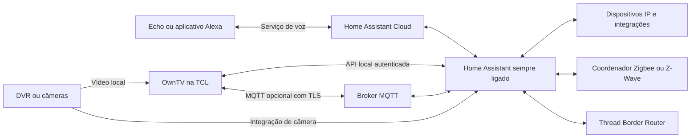

# OwnTV como central IoT e integração com Alexa

Estudo de viabilidade — 25 de outubro de 2026. Documento de arquitetura: os recursos descritos como proposta ainda não foram implementados nem testados na residência. Nenhum equipamento, credencial, assinatura ou configuração de rede foi alterado para este estudo.

**Recomendação:** usar a TV como painel da casa e ponte leve de comandos, com Home Assistant e, quando necessário, MQTT em um equipamento que permaneça ligado. Integrar Alexa pelo Home Assistant Cloud no primeiro estágio. A TV pode executar um gateway de aplicação experimental, mas não deve concentrar as automações que precisam continuar funcionando quando ela entra em espera, reinicia ou atualiza.

A diferença é importante: “gateway IoT” aqui significa traduzir eventos e comandos entre aplicações. Não significa transformar a TV em roteador de internet, firewall ou coordenador de todos os protocolos sem hardware adicional.

## 1. O que a TV já oferece e o que ainda precisa existir

A base considerada é a TCL já utilizada no projeto: Android TV 14, 3 GB de RAM, 64 GB de armazenamento e painel 4K. O código consultado do OwnTV declara `targetSdk = 34`; já possui launcher, reprodução de câmeras, configurações persistentes e serviço SSH separado. Isso não comprova funcionamento IoT contínuo em espera. Não há, nesta avaliação, comprovação de rádio Zigbee, Thread ou Z-Wave acessível ao aplicativo.

O SSH existente é administração local com o usuário do aplicativo; não transforma o OwnTV em root nem em serviço de sistema. Sua existência também não substitui uma API IoT. Uma integração deve oferecer comandos definidos — abrir câmeras, acionar uma cena, consultar estado — sem aceitar scripts ou shell enviados pela rede.

O painel 4K e o armazenamento são adequados para uma interface rica; não fornecem, por si só, capacidade de execução permanente. A adequação dos 3 GB para painel mais ponte leve é uma hipótese de engenharia a medir, sobretudo com reprodução de vídeo. Não foi feito benchmark de IoT neste estudo.

## 2. Comparação das arquiteturas

| Arquitetura | Vantagens | Limitações | Recomendação |
|---|---|---|---|
| OwnTV + Home Assistant em host sempre ligado | Automações independem da TV; integrações existentes; manutenção e backup centralizados | Precisa de um servidor disponível | Melhor caminho para uso diário |
| OwnTV + broker MQTT externo, sem Home Assistant | Ponte pequena e protocolo aberto; bom para dispositivos já em MQTT | Exige criar regras, painel e ligação com Alexa ou usar outro motor | Alternativa para quem já tem infraestrutura MQTT |
| Broker, regras e integrações dentro da TV | Usa o equipamento existente; interessante para laboratório | Standby, memória, atualizações, USB, rede e reinício viram pontos únicos de falha | Experimento para funções não críticas |
| OwnTV + nuvem própria + integração Alexa própria | Produto com experiência e marca próprias | Backend, identidade, operação, observabilidade e certificação ampliam o escopo | Evolução posterior, se houver distribuição para outros usuários |

Home Assistant oferece instalação em hardware dedicado, computadores, máquinas virtuais e contêineres. A lista oficial não oferece Android TV como instalação suportada do servidor. Para quem já tem um mini-PC, NAS ou servidor adequado, pode ser possível reaproveitá-lo; a compatibilidade concreta precisa ser conferida. Para reduzir manutenção, considerar Home Assistant OS em host suportado. A integração Matter recomenda o serviço Matter no Home Assistant OS como sua opção suportada. [Instalação do Home Assistant](https://www.home-assistant.io/installation/), [Matter no Home Assistant](https://www.home-assistant.io/integrations/matter/).

Arquitetura proposta:



Nesse desenho, desligar a TV remove o painel, mas não as regras da casa. Isso é uma consequência da arquitetura proposta; depende de Home Assistant, rede e dispositivos permanecerem alimentados. Dispositivos que dependem da nuvem do fabricante continuam dependendo dela.

## 3. O papel do OwnTV

Propor uma página **Casa**, com iluminação, climatização, cenas, sensores e câmeras, usando os mesmos tamanhos, foco e navegação do launcher. A página inicial permaneceria leve, com poucos atalhos escolhidos pelo usuário. Um estado indisponível deve aparecer claramente, sem exibir como atual um valor antigo.

O aplicativo pode receber estados via WebSocket e executar ações pelo Home Assistant. A API oficial autentica a sessão e permite assinatura de eventos e chamada de serviços. Isso evita consultar repetidamente todos os dispositivos. Após reconectar, o cliente deve refazer o estado inicial e as assinaturas; comando enviado não é sinônimo de dispositivo confirmado. [WebSocket API](https://contributors.home-assistant.io/core/internals/websocket-api/).

Para o primeiro protótipo, uma conta própria para a TV e um token revogável simplificam a configuração. O token deve ser tratado como credencial poderosa: não presumir que “usuário não administrador” oferece isolamento fino por dispositivo. Na versão distribuída, preferir fluxo de autenticação com revogação e renovação; caso seja necessário limitar rigorosamente entidades e operações, implementar essa lista permitida em uma ponte no servidor. Guardar credenciais com chave protegida pelo Android Keystore e excluí-las de logs e exportações. [Autenticação do Home Assistant](https://contributors.home-assistant.io/core/internals/auth-api/).

Uma segunda etapa pode publicar o próprio OwnTV como dispositivo no Home Assistant: disponibilidade, versão, tela atual, botão “abrir câmeras”, seleção de canal e cenas favoritas. MQTT Discovery reduz a configuração manual dessas entidades. Usar MQTT apenas quando resolver essa necessidade; o painel não precisa depender de dois protocolos desde o primeiro dia. [MQTT no Home Assistant](https://www.home-assistant.io/integrations/mqtt/).

Contrato proposto para uma ponte MQTT:

```text
owntv/<id-da-tv>/availability
owntv/<id-da-tv>/state
owntv/<id-da-tv>/command
owntv/<id-da-tv>/result/<id-do-comando>
```

Exemplo conceitual, ainda não implementado:

```json
{"id":"comando-unico","action":"open_camera","cameraId":"entrada","expiresAt":"2026-10-25T22:00:00Z"}
```

Decisões propostas: comandos sem retenção; validade curta; rejeição de comandos expirados; deduplicação por ID; resultado separado do estado observado; retenção somente de estado apropriado e disponibilidade. Nunca colocar senhas de câmera nos tópicos. A autorização do broker deve restringir cada TV aos seus tópicos, com autenticação individual e certificados TLS validados. [Autenticação do Eclipse Mosquitto](https://mosquitto.org/documentation/authentication-methods/).

## 4. Standby e limites do Android

O principal risco de hospedar tudo na TV é operacional. Android restringe tarefas de fundo; o fabricante determina parte das restrições. Um processo pode parar e o firmware pode retirar conectividade em espera. Não se deve manter a tela de 65 polegadas acesa para sustentar automações. [Restrições de tarefas em segundo plano](https://developer.android.com/develop/background-work/background-tasks/bg-work-restrictions).

**Não é correto afirmar que esta TCL necessariamente entra no mesmo Doze de um celular.** A documentação descreve condições de economia relacionadas ao aparelho desconectado de energia e sem uso; TVs normalmente permanecem alimentadas. Aqui é necessário medir o comportamento real do firmware, da rede e do processo durante espera, separadamente de um teste forçado de Doze. [Doze e App Standby](https://developer.android.com/training/monitoring-device-state/doze-standby).

No Android 14, serviços em primeiro plano exigem tipo e permissões correspondentes. Uma ponte contínua de dispositivos pode se enquadrar em `connectedDevice` quando satisfizer seus requisitos; não basta renomear o serviço SSH `specialUse`. Deve existir ativação explícita, indicação de funcionamento e opção de desligar. As regras de início em segundo plano e no boot precisam ser respeitadas. `START_STICKY` e um receptor de boot não garantem disponibilidade permanente. [Tipos de foreground service](https://developer.android.com/develop/background-work/services/fgs/service-types), [Restrições de início](https://developer.android.com/develop/background-work/services/fgs/restrictions-bg-start).

Há uma informação especialmente relevante: a integração oficial **Android TV Remote** informa que algumas TCL ficam indisponíveis após desligar, a menos que se habilite **Screenless service**, normalmente em Sistema → Energia. A presença, tradução e efeito dessa opção precisam ser conferidos no modelo usado. Ela não prova que nosso processo permaneça ativo. O controle por Android TV Remote exige o serviço correspondente na TV e pode lançar aplicativos ou deep links; a documentação registra limitações para alguns apps e para lançamento apenas pelo ID do pacote. [Android TV Remote](https://www.home-assistant.io/integrations/androidtv_remote/).

Receber MQTT também não dá autorização automática para abrir uma tela sobre qualquer outro aplicativo. O Android restringe lançamentos de atividades a partir do fundo. Para “mostrar câmera”, o fluxo deve trazer o OwnTV de modo suportado e então abrir a câmera, ou apresentar uma ação que o usuário confirme; a experiência deve ser testada com outro aplicativo aberto. Não ampliar o serviço de acessibilidade do Home para contornar permissões IoT. [Segurança de abertura de atividades](https://developer.android.com/guide/components/activities/secure-bal).

## 5. Matter, Thread, Zigbee e Z-Wave

| Tecnologia | O que é necessário | Papel recomendado da TV |
|---|---|---|
| Wi-Fi/Ethernet | Dispositivo com API ou integração compatível | Cliente ou ponte de aplicação na rede |
| MQTT | Broker e clientes; não é rádio | Publicar estados e receber comandos autenticados |
| Matter por Wi-Fi/Ethernet | Controlador e infraestrutura IPv6 compatíveis | Painel do controlador central |
| Matter por Thread | Controlador e Thread Border Router com rádio adequado | Usar a integração do servidor |
| Zigbee | Coordenador e rádio Zigbee compatíveis | Painel; coordenador no servidor ou gateway dedicado |
| Z-Wave | Controlador compatível e frequência da região | Painel; controlador no servidor |
| Bluetooth LE | Rádio acessível, permissões e suporte ao protocolo específico | Experimento posterior para dispositivos conhecidos |

Matter é protocolo de aplicação sobre IP; Thread é uma rede de rádio distinta. Bluetooth ou Wi-Fi na TV não comprovam rádio IEEE 802.15.4 disponível para Thread/Zigbee. Dispositivos Matter por Thread precisam de Border Router; outros por Wi-Fi não. Não contar com a TV como Border Router sem confirmação de hardware, firmware e implementação. [Matter](https://www.home-assistant.io/integrations/matter/).

Zigbee exige coordenador compatível e planejamento de rádio. Z-Wave exige equipamento da região correta; a frequência de dispositivos finais não pode ser presumida intercambiável. Para a primeira versão, usar os adaptadores no host do Home Assistant facilita suporte, backup e posicionamento. [ZHA](https://www.home-assistant.io/integrations/zha/), [Z-Wave](https://www.home-assistant.io/integrations/zwave_js/).

Conectar um dongle USB à TV não garante funcionamento: Android disponibiliza API USB Host, porém é preciso verificar enumeração, permissão do usuário, comunicação com aquele dispositivo, alimentação em espera e biblioteca/protocolo. Linux dentro de Android não equivale a uma distribuição pronta para executar qualquer daemon USB. [USB Host no Android](https://developer.android.com/develop/connectivity/usb/host).

Um protótipo aberto também não autoriza anunciar “Matter certificado” ou usar selos. A CSA descreve processo com associação, Vendor ID, plataforma/transporte, testes em laboratório autorizado e certificação. Adotar integrações de produtos certificados é diferente de certificar o OwnTV como produto ou bridge. [Certificação da CSA](https://csa-iot.org/certification/why-certify/).

## 6. Alexa: três caminhos

**A. Home Assistant Cloud — recomendado para começar.** Vincular a conta, escolher poucas entidades/cenas e testar no Echo ou aplicativo Alexa. O serviço dispensa configurar DNS dinâmico, certificado público e abertura de portas no roteador para a integração de voz. A operação local do Home Assistant é separada dessa ligação de voz, que depende dos serviços de nuvem. A página da Nabu Casa consultada anuncia o nome Home Assistant Link; partes da documentação continuam usando Cloud. [Alexa no Home Assistant](https://www.home-assistant.io/integrations/alexa/), [Nabu Casa](https://www.nabucasa.com/link/).

Exemplos de experiência a desenvolver e validar: “Alexa, ativar cinema” reduz a iluminação e seleciona a cena; “Alexa, ligar TV da sala” usa a integração que realmente consegue acordar a TCL; uma cena “Câmera da entrada” pode abrir essa visão no OwnTV. As frases são propostas, não confirmação de que todos os comandos arbitrários serão entendidos. “Mostrar a câmera no Echo Show” é outra integração, descrita abaixo.

**B. Integração Alexa manual com Home Assistant.** Dispensa a assinatura Nabu Casa, mas exige contas Amazon Developer/AWS, Lambda, configuração do endpoint, vinculação de contas e acesso HTTPS adequado ao Home Assistant. Há suporte oficial documentado, inclusive filtros de entidades. Isso transfere manutenção e eventuais custos para o operador; não representa ausência de nuvem. [Alexa Smart Home manual](https://www.home-assistant.io/integrations/alexa.smart_home/).

**C. Integração própria OwnTV.** Para um produto independente, implementar descoberta de dispositivos/capacidades e diretrizes Smart Home em backend/Lambda. Alexa conversa com esse backend; não se conecta diretamente ao broker MQTT doméstico por uma simples configuração. A ponte da casa poderia manter conexão de saída autenticada com o backend, evitando expor a TV à internet. [Arquitetura Alexa Smart Home](https://developer.amazon.com/docs/alexaplus/smarthome/connect-your-cloud-with-addons).

A conta do cliente precisa ser vinculada por OAuth 2.0, com autorização e renovação de tokens; PKCE pode integrar o fluxo compatível. Não embutir segredo de backend no APK. [Account linking](https://developer.amazon.com/docs/alexaplus/account-linking/standard-account-linking).

O backend deve responder estado e disponibilidade reais, tratar `ReportState` e enviar `ChangeReport` para propriedades anunciadas como proativas. Um “sucesso” por ter enfileirado o comando deixaria Alexa divergente da TV; a implementação precisa diferenciar aceitação, execução, erro e dispositivo indisponível. [State and change reporting](https://developer.amazon.com/docs/alexaplus/smarthome/state-reporting-for-smart-home-addons).

Para o Brasil, interfaces comuns como PowerController, SceneController e CameraStreamController listam `pt-BR`. Outras têm disponibilidade diferente; a tabela consultada não lista `pt-BR` para WakeOnLANController. Portanto, acordar a TV deve ser resolvido e testado na integração local, sem prometer essa interface Alexa em português. O fato de a documentação atual redirecionar para “Alexa+” também não comprova disponibilidade de todos os recursos na conta/região do usuário. [Interfaces e idiomas](https://developer.amazon.com/docs/device-apis/list-of-interfaces.html).

Integrar controles à Alexa não significa tornar a própria TV um Echo com palavra de ativação e escuta contínua. Isso é outro escopo. O MVP usa um dispositivo Alexa ou o aplicativo já disponível para receber a voz.

## 7. Câmeras: separar exibição na TV da exibição na Alexa

O OwnTV já reproduz o vídeo local; um comando pode selecionar uma câmera autorizada sem enviar suas credenciais ao serviço de voz. O identificador lógico `entrada` deve ser resolvido localmente. O fluxo preferido mantém DVR → TV dentro da rede.

Para mostrar no Echo Show, uma URL RTSP doméstica existente não basta em todos os casos. A interface CameraStreamController exige formatos, codecs, segurança e acessibilidade de fluxo compatíveis. No caminho RTSP documentado, há requisitos de TCP intercalado na porta 443 e TLS 1.2; URI apenas local limita os aparelhos que conseguem visualizar. Portanto, não publicar a porta RTSP do DVR na internet. [Alexa CameraStreamController](https://developer.amazon.com/docs/alexaplus/device-apis/alexa-camerastreamcontroller).

O caminho com Home Assistant requer a integração `stream`, URL alcançável pelo Echo e HTTPS na porta 443 com certificado aceito; Home Assistant Cloud é uma opção descrita para satisfazer esses requisitos. Testar primeiro uma câmera, codecs e tempo de início. Se houver necessidade de conversão/transcodificação, executá-la no servidor adequado, não junto do launcher na TCL. [Câmeras na integração Alexa do Home Assistant](https://www.home-assistant.io/integrations/alexa.smart_home/#camera).

## 8. Plano de implementação proposto

| Etapa | Entrega | Critério de conclusão |
|---|---|---|
| 0 — Inventário | Lista de dispositivos, protocolos, host existente, Echo/modelos e rotina desejada | Saber o que já pode ser reutilizado e o que falta |
| 1 — Painel local | Página Casa; integração autenticada; luz, sensor e cena | Estado confirmado, falhas visíveis e navegação fluida |
| 2 — Ponte OwnTV | Disponibilidade, abrir painel/câmera e retorno de resultado | Reconexão, deduplicação e comandos expirados funcionando |
| 3 — Alexa | Vinculação Cloud e poucas entidades/cenas escolhidas | Comandos em português testados com TV ligada e em espera |
| 4 — Robustez | Testes de falhas, métricas e backup/restauração | Automações da casa continuam sem a TV |
| 5 — Expansão | Protocolos/radios adicionais; eventual backend próprio | Necessidade comprovada, compatibilidade e manutenção definidas |

Organização sugerida para o código futuro: camada `iot/domain` para comandos/estado, `iot/homeassistant` para API, `iot/mqtt` opcional, `iot/service` para ciclo de vida e `ui/home` para apresentação. Contratos sem dependência da UI; acesso à câmera e navegação através de ações explícitas. Configuração desativada por padrão, com diagnóstico “servidor conectado / última atualização / última falha” sem segredos. Nenhum desses módulos deve aparecer como recurso pronto antes de ser implementado.

## 9. Testes de aceitação e segurança

Plano proposto, ainda não executado:

- Testar TV ligada, OwnTV aberto, outro aplicativo aberto, tela em espera, espera prolongada, reboot e atualização do APK; observar separadamente conectividade do sistema e processo OwnTV.
- Fazer ensaio de 72 horas com fases de espera, reconexão e uso normal. Medir memória, CPU, fluidez, tempo de comando e consumo; comparar com o launcher sem IoT.
- Interromper internet mantendo LAN: comandos locais e regras locais devem continuar quando os dispositivos forem locais; voz Alexa pode ficar indisponível.
- Reiniciar broker/Home Assistant e trocar conexão da TV: refazer estado sem duplicar ação; recusar comandos antigos; sinalizar indisponibilidade.
- Revogar token, apresentar certificado inválido e credencial incorreta: conexão negada e segredo ausente dos logs.
- Testar eventos duplicados, fora de ordem e comandos simultâneos; impedir loops entre estado MQTT, Home Assistant e Alexa.
- Testar uma câmera e depois a carga autorizada, sem transcodificação concorrente na TV; medir impacto sobre a navegação.
- Restaurar backup em ambiente de teste e validar que credenciais privadas não entram no repositório ou artefatos públicos.

Usar TLS validado, credenciais por dispositivo e permissões mínimas. Evitar portas públicas para ADB, SSH, MQTT e DVR. Se houver redes separadas, liberar somente fluxos necessários; Matter/Thread exigem atenção especial a IPv6 e descoberta, portanto segmentar sem planejamento pode quebrar pareamento. Fechaduras, portões, alarmes e funções de segurança devem seguir as políticas próprias de autorização e confirmação, não o mesmo botão genérico de uma luz.

## 10. Custos e decisão prática

A primeira decisão deve ser aproveitar infraestrutura já existente. O estudo não presume que há Home Assistant, broker, NAS, servidor ou Echo disponível e não seleciona uma compra sem esse inventário.

A página oficial consultada da Nabu Casa apresenta referência de **US$ 6,50/mês ou US$ 65/ano, sem impostos**, na opção exibida em USD. Conferir região, impostos, moeda e condição final na contratação; não converter para reais como se fosse preço local. O controle local pelo Home Assistant não exige essa assinatura. [Preço publicado da Nabu Casa](https://www.nabucasa.com/link/).

Na alternativa própria, Lambda cobra conforme uso e existem limites/condições de gratuidade; backend, domínio, armazenamento, logs, transferência e eventual relay de vídeo também entram na conta. Não é possível garantir custo zero sem arquitetura e volume. [Preços AWS Lambda](https://aws.amazon.com/lambda/pricing/).

**Próximo passo recomendado:** inventariar os dispositivos e o equipamento que pode ficar ligado, então implementar primeiro o painel local com uma luz, um sensor e uma cena. Em seguida adicionar Alexa e controle do OwnTV. Hospedar toda a casa na TV só faria sentido como experimento após comprovar o comportamento em espera e aceitar que a TV seja um ponto único de falha.
